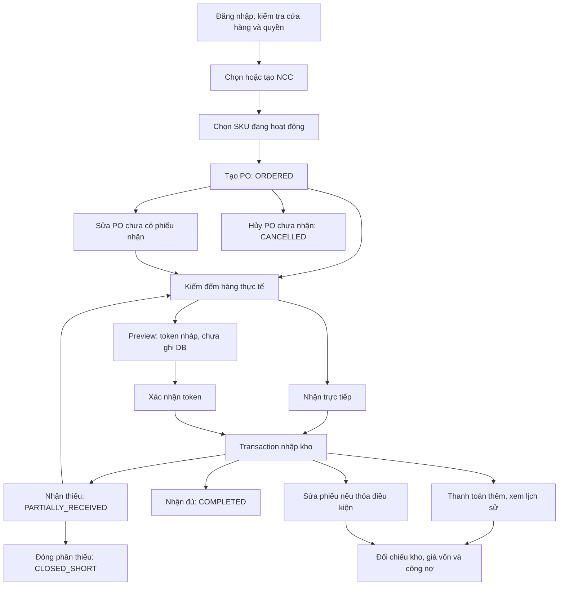

# F03 — Đặt mua, nhận hàng và thanh toán nhà cung cấp

## Cập nhật luồng NCC theo schema suppliers / supplier_products (05/11/2026)

1. Tạo hoặc sửa hồ sơ NCC: mã NCC, tên, liên hệ, email, địa chỉ, mã số thuế, ghi chú và trạng thái hợp tác. Mã và điện thoại không trùng trong cùng cửa hàng; chuỗi trống được lưu null. Không sửa công nợ qua hồ sơ.
2. Khai báo SKU đang cung cấp: mã/tên hàng NCC, giá chào VND trên một đơn vị tồn kho, lượng đặt tối thiểu, bội số đặt, ngày giao (null dùng mặc định SKU), ưu tiên và ghi chú. Chỉ có một NCC ưu tiên đang hoạt động cho mỗi SKU. Đổi ưu tiên trong transaction có retry khi xung đột.
3. Tạo PO: chọn NCC đang hợp tác → chọn hàng trong danh mục NCC → điền giá chào và lượng nhỏ nhất thỏa tối thiểu/bội số → người dùng chọn ngày giao, có thể sửa giá thỏa thuận → lưu. Backend kiểm tra lại danh mục và điều kiện trong transaction. Đổi NCC trên form xóa các dòng chọn trước đó.
4. Ngừng cung cấp SKU giữ dòng cũ và bỏ ưu tiên; lưu lại kích hoạt chính dòng đó. Danh mục lọc `isActive=true|false|all`, mặc định true. Tab lịch sử chỉ dựa trên phiếu RECEIVED và vẫn hiển thị hàng đã ngừng; lịch sử không tự trở thành danh mục cung cấp.
5. Ngừng hợp tác NCC chặn đặt mới và sửa dòng mua, bỏ ưu tiên của NCC. Đơn cũ vẫn nhận phần còn lại, thanh toán và đối soát. Sửa ngày/mã đơn với các dòng cũ giữ nguyên không buộc khai báo lại danh mục; thay NCC, đổi giá/lượng hoặc thêm dòng phải kiểm tra điều kiện hiện tại. Các kiểm tra SKU hoạt động, khóa kiểm kê và lô khi nhận vẫn áp dụng.
6. Giá chào không tự đổi giá vốn hoặc chứng từ; nhận hàng tiếp tục dùng giá thực nhận, tính kho/công nợ và thanh toán trong transaction hiện có.

API bổ sung: `PATCH /purchases/suppliers/:id`. GET suppliers hỗ trợ `isActive=true|false|all` (mặc định tất cả); tìm theo mã, tên, email, điện thoại hoặc người liên hệ. PUT products nhận đầy đủ điều kiện trên, DELETE products là ngừng cung cấp. Swagger `/fo3/` đã đồng bộ endpoint và payload.

Triển khai cần schema/migration `20261104090000_f03_supplier_catalog` đã có trong checkout và Prisma Client được generate lại. Không chạy migration tự động lên DB từ thao tác sửa mã nguồn. Với dữ liệu cũ, khai báo/xác nhận danh mục trước khi tạo đơn mới; không tự lấy giá vốn hay lịch sử nhận làm giá chào.


Tài liệu mô tả hành vi backend hiện tại, toàn bộ API purchases và quy trình test bằng Postman. PO là đơn đặt mua; phiếu nhận xác nhận hàng thực tế nhập kho; NCC là nhà cung cấp.

## 1. Luồng hoạt động



### Trạng thái và tác động dữ liệu

| Thao tác | Điều kiện / kết quả | Tồn kho và công nợ |
| --- | --- | --- |
| Tạo PO | ORDERED; receivedQty = 0 | Chưa thay đổi |
| Sửa PO | ORDERED, chưa có bất kỳ phiếu nhận nào, kể cả phiếu đã hủy | Chưa thay đổi |
| Kiểm đếm nháp | Response DRAFT, token có chữ ký, sống 1 giờ | Không lưu chứng từ, không giữ chỗ số lượng/mã phiếu, không ghi kho/nợ/chi tiền |
| Nhận một phần / nhận đủ | PARTIALLY_RECEIVED / COMPLETED; phiếu RECEIVED | Tăng tồn thực nhận, tăng nợ bằng tiền hàng trừ tiền trả |
| Hủy PO | Chưa nhận; thành CANCELLED | Không thay đổi |
| Đóng phần thiếu | Đã nhận một phần, còn thiếu; thành CLOSED_SHORT | Giữ nguyên lượng đặt/đã nhận, tồn và tiền |
| Thanh toán thêm | Tổng đã trả mới >= tổng cũ và <= tổng phiếu | Giảm nợ bằng phần tăng; ghi khoản chi |
| Sửa phiếu nhận | Sửa lượng/giá khi chưa có giao dịch kho tiếp theo trên SKU và thỏa các ràng buộc | Điều chỉnh tồn, giá vốn, PO và nợ cùng transaction |
| Đối soát công nợ | GET xem; POST áp dụng | POST ghi nợ NCC theo cơ sở chứng từ |

PO COMPLETED/CANCELLED/CLOSED_SHORT không nhận thêm được. Gửi lại thao tác hủy/đóng đã thành công trả lại PO, không thay đổi số liệu thêm lần nữa. Sửa phiếu tính lại trạng thái PO: nhận đủ thành COMPLETED; nếu vẫn thiếu và trước đó CLOSED_SHORT thì giữ CLOSED_SHORT; còn lại theo lượng đã nhận.

Phiếu nhận trong DB chỉ có RECEIVED/CANCELLED. DRAFT chỉ là token do client giữ; chưa có API hủy phiếu nhận.

### Transaction nhận hàng

1. Kiểm tra người thao tác đang hoạt động, PO thuộc cửa hàng và còn mở; kiểm tra fingerprint PO nếu xác nhận nháp.
2. Kiểm tra NCC, dòng PO, tổng nhận theo từng dòng không vượt phần còn thiếu.
3. Tạo phiếu RECEIVED. Nếu trả tiền > 0, tìm ca OPEN của chính người thao tác và tạo CashTransaction.
4. Kiểm tra SKU hoạt động, không khóa kiểm kê; kiểm tra hoặc tạo lô.
5. Tăng InventoryBalance, cập nhật ProductVariant.costPrice, tạo PurchaseReceiptItem và InventoryLedger PURCHASE_RECEIPT.
6. Tăng PurchaseOrderItem.receivedQty, cập nhật trạng thái PO, tăng Supplier.debtAmount bằng totalAmount - paidAmount.
7. Commit toàn bộ; lỗi ở bất kỳ bước nào rollback cả phiếu, lô mới, tồn, ledger, khoản chi, PO và công nợ.

Helper transaction dùng Serializable, timeout 30 giây; khi gặp Prisma P2034 thử tối đa **3 lần tổng cộng**, sau đó trả 409. Tạo NCC là một lệnh ghi riêng, không dùng helper này.

### Công thức và quy tắc chung

- Tổng phiếu = sum(receivedQty × actualCost); nợ phiếu = totalAmount - paidAmount.
- Giá trị đặt PO = sum(orderedQty × unitPrice). Công nợ PO chỉ tính phiếu RECEIVED, không bao gồm hàng chưa giao. Phiếu CANCELLED vẫn hiện trong lịch sử.
- Giá vốn nhận = (tồn trước × giá vốn trước + tổng giá trị nhận) / (tồn trước + lượng nhận), làm tròn 2 chữ số. Tồn trước <= 0 được tính là 0 cả lượng và giá trị. Nhiều lô cùng SKU được cộng giá trị chưa làm tròn trước khi chốt giá vốn.
- Payment dùng **tổng đã trả**, không phải số trả thêm. Khoản chi mới = tổng mới - tổng cũ; cùng tổng không tạo lịch sử mới.
- Khoản chi > 0 tạo CashTransaction OUT, category SUPPLIER_PAYMENT, refDocType PURCHASE_RECEIPT, refDocId là ID phiếu, gắn ca và người ghi nhận.
- Lượng là số nguyên từ 1 đến 2.147.483.647; items có 1–500 dòng. PO không lặp SKU. Phiếu nhận được lặp poItemId để chia lô, nhưng tổng không vượt phần còn thiếu.
- Tiền không âm, tối đa 2 chữ số thập phân; nên gửi chuỗi decimal. Giá đơn vị, openingCash và mỗi khoản chi < 10.000.000.000; tổng phiếu/tổng đã trả < 1.000.000.000.000. Nợ NCC có thể âm, trị tuyệt đối < 10.000.000.000.
- Tiền response là chuỗi decimal; không giả định mọi trường đều có hậu tố .00. Các trường tính toán như totals dùng định dạng 2 chữ số.
- poCode/receiptCode bắt buộc, tối đa 50 ký tự, duy nhất trong cửa hàng. Sau mất kết nối, GET kiểm tra mã cũ trước khi retry; đổi mã có thể nhập hàng hai lần.
- Ngày body dùng YYYY-MM-DD. orderDate mặc định theo ngày Việt Nam; ngày giao dự kiến bắt buộc và không trước ngày đặt. receivedAt lấy từ server.
- SKU quản lý lô cần lotNumber (tối đa 100 ký tự), expirationDate; manufacturingDate tùy chọn và không sau hạn dùng. Lô cũ phải cùng hạn dùng và cùng ngày sản xuất nếu gửi ngày này; không cập nhật ngày lô cũ.
- Lô hết hạn trước hôm nay theo Việt Nam UTC+7 trả 400; hết hạn đúng hôm nay vẫn nhận được. SKU không quản lý lô không được gửi trường lô.

## 2. Toàn bộ API F03

Base URL mặc định: `http://localhost:5000/api`. Các đường dẫn sau nối vào base URL.

Tất cả API purchases cần Bearer token, membership cửa hàng, **inventory.read + finance.read**. Cột quyền dưới đây là quyền bổ sung. businessId lấy từ membership; cố gửi businessId cửa hàng khác trong body/query trả 403. ID dữ liệu thuộc cửa hàng khác được xử lý như không tìm thấy.

| # | Method | Đường dẫn | Chức năng | HTTP thành công | Quyền bổ sung |
| --- | --- | --- | --- | --- | --- |
| 1 | GET | /purchases/suppliers | Danh sách NCC và nợ đang lưu | 200 | — |
| 2 | POST | /purchases/suppliers | Tạo NCC | 201 | inventory.receive |
| 3 | GET | /purchases/orders | PO, SKU, đợt nhận và totals | 200 | — |
| 4 | GET | /purchases/orders/:id | Chi tiết PO | 200 | — |
| 5 | POST | /purchases/orders | Tạo PO ORDERED | 201 | inventory.receive |
| 6 | PATCH | /purchases/orders/:id | Sửa PO chưa có phiếu nhận | 200 | inventory.receive |
| 7 | POST | /purchases/orders/:id/cancel | Hủy PO chưa nhận | 200 | inventory.receive |
| 8 | POST | /purchases/orders/:id/close | Đóng phần giao thiếu | 200 | inventory.receive |
| 9 | POST | /purchases/orders/:id/receipts | Nhận hàng ngay | 201 | inventory.receive |
| 10 | POST | /purchases/orders/:id/receipt-drafts | Kiểm đếm, cấp token nháp | 201 | inventory.receive |
| 11 | POST | /purchases/orders/:id/receipt-drafts/confirm | Xác nhận nháp, nhập kho | 201 | inventory.receive |
| 12 | GET | /purchases/receipts | Danh sách phiếu nhận | 200 | — |
| 13 | GET | /purchases/receipts/:id | Phiếu, dòng SKU/lô/PO, ledger nhập và sửa | 200 | — |
| 14 | PATCH | /purchases/receipts/:id/items | Sửa lượng/giá đã nhận | 200 | inventory.receive + inventory.adjust |
| 15 | PATCH | /purchases/receipts/:id/payment | Cập nhật tổng đã trả | 200 | inventory.receive |
| 16 | GET | /purchases/receipts/:id/payments | Lịch sử khoản chi NCC | 200 | — |
| 17 | POST | /purchases/cash-shifts | Mở hoặc lấy ca OPEN hiện có | **200** | inventory.receive |
| 18 | GET | /purchases/cash-shifts/current | Ca OPEN hoặc JSON null | 200 | — |
| 19 | GET | /purchases/suppliers/:id/debt-reconciliation | Preview đối soát, không ghi dữ liệu | 200 | — |
| 20 | POST | /purchases/suppliers/:id/debt-reconciliation | Áp dụng công nợ tính lại | 200 | inventory.receive |

API liên quan để chuẩn bị và đối chiếu:

| Method | Đường dẫn | Sử dụng |
| --- | --- | --- |
| GET | /health | Kiểm tra server, không cần token; không chứng minh DB kết nối tốt |
| GET | /auth/me | Xác nhận token, cửa hàng, danh sách quyền |
| GET | /inventory/variants?search=... | Lấy ID SKU, tồn và giá vốn; cần inventory.read |
| GET | /inventory/lots?variantId=<UUID> | Xem lô SKU; cần inventory.read |
| GET | /inventory/ledger | Xem lịch sử kho; cần inventory.read |

### Query và response đọc

- Ba API danh sách purchases trả `{ items, pagination: { page, pageSize, total, totalPages } }`.
- page mặc định 1, tối đa 1.000.000; pageSize mặc định 20, tối đa 100; search tối đa 255 ký tự.
- PO hỗ trợ supplierId, status, from, to; lọc theo orderDate. Status: ORDERED, PARTIALLY_RECEIVED, COMPLETED, CLOSED_SHORT, CANCELLED.
- Phiếu hỗ trợ các filter trên và poId; lọc theo receivedAt. Status: RECEIVED, CANCELLED.
- from/to dùng YYYY-MM-DD, gồm cả hai ngày theo UTC; from <= to.
- NCC dùng page/pageSize/search; tìm theo tên, điện thoại, người liên hệ. Không dùng filter trạng thái/ngày/NCC cho danh sách NCC.
- Search PO theo mã PO/tên NCC/SKU; search phiếu theo mã phiếu/mã PO/tên NCC/SKU.
- Chi tiết PO có purchaseOrderItems[].remainingQty/subtotal, purchaseReceipts, totals gồm orderedQty, receivedQty, orderedAmount, receivedAmount, paidAmount, debtAmount.
- Chi tiết phiếu có purchaseReceiptItems[].subtotal, lot, poItem, inventoryLedger. Ledger là lịch sử, không phải tồn hiện tại. GET không tự sửa dữ liệu.

Ví dụ: `/purchases/receipts?poId={{poId}}&status=RECEIVED&page=1&pageSize=20`.

## 3. Chuẩn bị test Purchase Order

Chạy luồng chính ở mục 4 trước, sau đó dùng PO mới cho từng nhánh ở mục 5. Có thể dùng Swagger hoặc Postman; cả hai gọi cùng API và ghi dữ liệu thật vào DB thử nghiệm.

Điều kiện trước khi bắt đầu:

- Backend kết nối DB thử nghiệm đã áp dụng migration và cấu hình Supabase trong `.env`.
- Tài khoản đã thuộc cửa hàng, có `inventory.read`, `finance.read`, `inventory.receive`. Riêng test sửa phiếu nhận cần thêm `inventory.adjust`.
- Có một SKU đang hoạt động, không quản lý lô và không khóa kiểm kê cho luồng chính.
- Không bán, xuất, nhập hoặc điều chỉnh SKU này trong lúc test. Ghi lại tồn đầu `Q0`, giá vốn đầu `C0`, nợ NCC đầu `D0` để đối chiếu.

### Swagger riêng `fo3`

Chạy backend bằng `npm run dev`, mở **http://localhost:5000/fo3/** (đổi cổng nếu cấu hình PORT khác).
OpenAPI JSON: **http://localhost:5000/fo3/openapi.json**.

Swagger chỉ chứa các API phục vụ F03: đăng nhập, kiểm tra tài khoản/quyền, SKU/lô/ledger và đủ 20 API purchases ở mục 2.

1. Backend cần `SUPABASE_URL` và `SUPABASE_ANON_KEY` trong `.env` để hiển thị API đăng nhập. Đây là public anon key, không dùng service-role key.
2. Mở nhóm **00. Đăng nhập** → `POST /auth/v1/token` → **Try it out**, nhập email/password tài khoản hiện có rồi **Execute**. Request đi trực tiếp đến Supabase, giống frontend. Nếu bật CAPTCHA, cần gửi `gotrue_meta_security.captcha_token` hợp lệ.
3. Khi đăng nhập thành công, Swagger tự **Authorize** bằng `access_token`. Token chỉ giữ trong bộ nhớ trang; tải lại trang hoặc token hết hạn cần đăng nhập lại. Tài khoản Google có thể lấy access token từ frontend rồi dán vào **Authorize** (chỉ token, không thêm `Bearer`).
4. Gọi `GET /auth/me`, kiểm tra cửa hàng và quyền. Các API purchases cần `inventory.read` + `finance.read`; thao tác ghi cần thêm `inventory.receive`, sửa phiếu cần thêm `inventory.adjust`.
5. Thực hiện các bước ở mục 4. Với route có `{id}`, nhập ID vào ô path parameter. Thay mọi `{{biến}}` trong body bằng giá trị thật vì Swagger không tự thay biến như Postman. Dùng mã PO/phiếu mới mỗi lần test và mở ca trước khi trả tiền NCC.

### Thiết lập Postman

1. Tại `abc-backend`, chạy `npm run dev`.
2. Tạo Environment trong Postman với các biến bên dưới; chọn Environment đó trước khi gửi request.
3. Đăng nhập frontend. Vào DevTools → Network → request `/auth/me` → Request Headers, lấy phần token sau `Bearer` và lưu vào biến `token`.
4. Tạo Collection, đặt Authorization là **Bearer Token**, giá trị `{{token}}`. Các request chọn **Inherit auth from parent**. Request có body chọn **raw → JSON**, header `Content-Type: application/json`.
5. Gửi `GET {{baseUrl}}/auth/me`, kiểm tra đúng cửa hàng và đủ quyền. Gửi `GET {{baseUrl}}/inventory/variants?search=<SKU>` để lấy ID và ghi tồn/giá vốn đầu của đúng SKU.

| Biến môi trường Postman | Giá trị / cách lấy |
| --- | --- |
| baseUrl | http://localhost:5000/api |
| token | Access token hợp lệ |
| runId | Hậu tố duy nhất mỗi lần test, ví dụ 20261101-01; đổi khi chạy lại |
| variantId | ID SKU đang hoạt động từ inventory/variants |
| supplierId | ID NCC ở bước 4.1 |
| poId, poItemId | ID PO và purchaseOrderItems[0].id |
| receiptId, receiptItemId | ID phiếu đợt 1 và purchaseReceiptItems[0].id |
| receipt2Id | ID phiếu đợt 2 |
| shiftId | ID ca OPEN của chính người test |
| draftToken | Token nháp nếu test nhánh nháp |

Mỗi đường dẫn bên dưới nối vào `{{baseUrl}}`. Ví dụ: `GET {{baseUrl}}/purchases/orders/{{poId}}`. ID cần dùng là UUID trong response, không phải mã hiển thị `poCode`, `receiptCode` hay mã SKU. Các biến ID chưa có thì để trống và điền sau bước tạo tương ứng.

## 4. Test luồng chính: đặt 10 → nhận 4 → trả thêm → nhận 6

Mục tiêu: tạo PO 10 sản phẩm, giá đặt và giá nhận đều 50000/sản phẩm; nhận hai đợt, tổng trả 150000. Khi hoàn tất, PO phải nhận đủ 10, tổng tiền nhận 500000 và còn nợ 350000.

Thực hiện tuần tự 4.1–4.6 trên cùng một PO. Sau mỗi thao tác ghi, gọi lại API đọc để kiểm tra dữ liệu đã lưu. Các trường `totals` và `remainingQty` được kiểm tra qua `GET /purchases/orders/{{poId}}`, không yêu cầu response tạo/sửa PO có các trường tính toán này.

### 4.1. Tạo và tìm NCC

`POST /purchases/suppliers`

```json
{
  "name": "NCC F03 {{runId}}",
  "phone": "0901234567",
  "contactPerson": "Anh An"
}
```

**Kết quả cần kiểm tra:** HTTP **201**, response có `id` và đúng tên NCC. Lưu `response.id` vào `supplierId`.

Gửi `GET /purchases/suppliers?search={{runId}}`: HTTP **200**, tìm dòng có `id = supplierId` trong `items`, ghi `debtAmount` làm `D0`. Với NCC mới, `D0` phải bằng 0.

`name` bắt buộc (1–255 ký tự); `phone` tùy chọn (1–20), `contactPerson` tùy chọn (1–100); nếu gửi thì không được rỗng.

### 4.2. Tạo và xem PO

`POST /purchases/orders`

```json
{
  "poCode": "PO-{{runId}}",
  "expectedDeliveryDate": "{{expectedDeliveryDate}}",
  "supplierId": "{{supplierId}}",
  "items": [
    { "variantId": "{{variantId}}", "orderedQty": 10, "unitPrice": "50000.00" }
  ]
}
```

**Kết quả cần kiểm tra:** HTTP **201**, `status = ORDERED`, đúng NCC và một dòng đặt 10 × 50000. Lưu:

- `response.id` → `poId`.
- `response.purchaseOrderItems[0].id` → `poItemId`. Đây là ID dòng đặt hàng, khác `variantId`.

Body trên dùng ngày đặt mặc định theo ngày Việt Nam. Đặt biến `expectedDeliveryDate` theo `YYYY-MM-DD`, bằng hoặc sau ngày đặt. Ngày giao dự kiến bắt buộc khi tạo hoặc sửa đơn; thiếu ngày trả HTTP **400**. Đơn cũ chưa có ngày phải bổ sung khi sửa.

Gọi `GET /purchases/orders/{{poId}}` và `GET /purchases/orders?search=PO-{{runId}}`:

| Trường / dữ liệu | Kết quả mong đợi |
| --- | --- |
| status | ORDERED |
| purchaseOrderItems[0].orderedQty / receivedQty / remainingQty | 10 / 0 / 10 |
| totals.orderedAmount | "500000.00" |
| totals.receivedAmount / paidAmount / debtAmount | Đều "0.00" |
| Danh sách PO | `items` có PO vừa tạo, đúng `id` và `poCode` |
| Tồn / giá vốn / nợ NCC | Vẫn là Q0 / C0 / D0 |
| Phiếu nhận và ledger nhập của PO | Chưa có |

### 4.3. Mở ca

`GET /purchases/cash-shifts/current`: 200, ca hiện có hoặc null.

`POST /purchases/cash-shifts`

```json
{ "openingCash": "0.00" }
```

**Kết quả cần kiểm tra:** HTTP **200**, `status = OPEN`; lưu `response.id` vào `shiftId`. Gọi lại `GET /purchases/cash-shifts/current` phải thấy cùng ID.

Gửi lại POST phải trả ca hiện có, không cộng thêm `openingCash`. Không gửi `openingCash` thì mặc định 0. Ca phải thuộc chính người đang test. Chưa hỗ trợ đóng ca/đối soát quỹ.

### 4.4. Nhận đợt 1 trực tiếp

`POST /purchases/orders/{{poId}}/receipts`

```json
{
  "receiptCode": "PR-{{runId}}-01",
  "paidAmount": "100000.00",
  "shiftId": "{{shiftId}}",
  "items": [
    { "poItemId": "{{poItemId}}", "receivedQty": 4, "actualCost": "50000.00" }
  ]
}
```

**Kết quả cần kiểm tra:** HTTP **201**, `status = RECEIVED`. Lưu `response.id` vào `receiptId`, `response.purchaseReceiptItems[0].id` vào `receiptItemId`.

Endpoint này nhập kho ngay. `paidAmount` mặc định 0; `shiftId` tùy chọn, server chọn ca OPEN mới nhất của chính người thao tác nếu không gửi. Trả 0 không cần ca.

Gửi các request đọc sau để đối chiếu:

| Request | Kết quả mong đợi |
| --- | --- |
| GET /purchases/orders/{{poId}} | PARTIALLY_RECEIVED; nhận 4/còn 6; totals nhận 200000/trả 100000/nợ 100000 |
| GET /purchases/receipts/{{receiptId}} | RECEIVED; dòng nhận 4 × 50000; totalAmount 200000, paidAmount 100000, debtAmount 100000; inventoryLedger có PURCHASE_RECEIPT +4 |
| GET /purchases/suppliers?search={{runId}} | NCC đang test có nợ D0 + 100000 |
| GET /inventory/variants?search=<SKU> | Đúng SKU có tồn Q0 + 4; giá vốn theo công thức mục 1 |
| GET /purchases/receipts/{{receiptId}}/payments | Một khoản chi 100000; recordedPaymentAmount 100000, untrackedPaidAmount 0, historyComplete true |

### 4.5. Thanh toán thêm

`PATCH /purchases/receipts/{{receiptId}}/payment`

```json
{ "paidAmount": "150000.00", "shiftId": "{{shiftId}}" }
```

`paidAmount` là **tổng tiền đã trả cho phiếu**, nên gửi 150000 để trả thêm 50000 sau lần đầu đã trả 100000.

**Kết quả cần kiểm tra:** HTTP **200**. Gọi lại chi tiết phiếu, PO, NCC và lịch sử thanh toán:

- Phiếu tổng 200000, đã trả 150000, nợ 50000; `totals` của PO cũng phản ánh các số này.
- Nợ NCC = D0 + 50000; tồn, giá vốn và lượng nhận của PO giữ nguyên so với bước 4.4.
- Lịch sử có 2 khoản chi: 100000 và **50000**; `recordedPaymentAmount = 150000`, `untrackedPaidAmount = 0`, `historyComplete = true`.

Gửi lại đúng body một lần nữa: HTTP **200**, lịch sử vẫn chỉ 2 khoản chi và nợ không giảm thêm. Thử riêng `paidAmount = "100000.00"` và `"200001.00"`: đều HTTP **400**; GET lại phải thấy tổng đã trả vẫn 150000 và các số liệu giữ nguyên.

### 4.6. Nhận đợt 2 và hoàn tất

`POST /purchases/orders/{{poId}}/receipts`

```json
{
  "receiptCode": "PR-{{runId}}-02",
  "paidAmount": "0.00",
  "items": [
    { "poItemId": "{{poItemId}}", "receivedQty": 6, "actualCost": "50000.00" }
  ]
}
```

**Kết quả cần kiểm tra:** HTTP **201**, phiếu RECEIVED; lưu `response.id` vào `receipt2Id`. Đối chiếu:

| API | Kết quả mong đợi |
| --- | --- |
| GET /purchases/orders/{{poId}} | COMPLETED, nhận 10/còn 0; totals nhận 500000/trả 150000/nợ 350000 |
| GET /purchases/receipts?poId={{poId}} | 2 phiếu RECEIVED; phiếu đợt 2 tổng/nợ 300000 |
| GET /purchases/receipts/{{receipt2Id}} | Dòng nhận 6, ledger nhập +6 |
| GET /purchases/receipts/{{receipt2Id}}/payments | items rỗng, tiền trả bằng 0, historyComplete = true |
| GET /purchases/suppliers?search={{runId}} | Nợ = D0 + 350000 |
| GET /inventory/variants?search=... | Tồn Q0 + 10; giá vốn theo công thức, có thể khác 50000 nếu có tồn đầu |
| GET /inventory/ledger | Hai đợt nhập tham chiếu đúng hai phiếu |

Cuối cùng, thử nhận thêm 1 sản phẩm bằng **mã phiếu mới** `PR-{{runId}}-03` và cùng `poItemId`: HTTP **409** vì PO đã hoàn tất. GET lại phải vẫn có 2 phiếu, tồn Q0 + 10 và nợ NCC D0 + 350000; không phát sinh ledger hoặc khoản chi mới.

### 4.7. Bảng chốt kết quả luồng chính

Các số tiền dưới đây là giá trị số để đối chiếu; tiền trong JSON trả về dạng chuỗi decimal.

| Sau bước | Trạng thái PO | Đã nhận / còn thiếu | Tiền hàng đã nhận | Tổng đã trả | Nợ PO | Tồn SKU | Nợ NCC |
| --- | --- | --- | --- | --- | --- | --- | --- |
| Tạo PO | ORDERED | 0 / 10 | 0 | 0 | 0 | Q0 | D0 |
| Nhận đợt 1 | PARTIALLY_RECEIVED | 4 / 6 | 200000 | 100000 | 100000 | Q0 + 4 | D0 + 100000 |
| Trả thêm 50000 | PARTIALLY_RECEIVED | 4 / 6 | 200000 | 150000 | 50000 | Q0 + 4 | D0 + 50000 |
| Nhận đợt 2 | COMPLETED | 10 / 0 | 500000 | 150000 | 350000 | Q0 + 10 | D0 + 350000 |

Luồng chính PASS khi cả trạng thái, số lượng, tiền, tồn, ledger và lịch sử thanh toán đều khớp. HTTP thành công nhưng số liệu không khớp vẫn là FAIL.

## 5. Test các nhánh độc lập

Dùng PO/SKU riêng từng nhánh. Test sửa phiếu phải thực hiện trước giao dịch kho tiếp theo trên SKU.

### 5.1. Sửa, hủy, đóng PO

Không dùng PO đã COMPLETED ở mục 4. Tạo hai PO mới theo body bước 4.2, mỗi PO đặt 10 × 50000, dùng mã khác nhau và lưu ID riêng:

| PO | poCode | Biến ID | Mục đích |
| --- | --- | --- | --- |
| A | PO-EDIT-{{runId}} | poEditId | Sửa rồi hủy khi chưa nhận |
| B | PO-CLOSE-{{runId}} | poCloseId | Nhận một phần rồi đóng phần thiếu |

**A. Sửa PO chưa nhận**

Ghi lại ID dòng của PO A, sau đó gửi `PATCH /purchases/orders/{{poEditId}}`:

```json
{
  "items": [
    { "variantId": "{{variantId}}", "orderedQty": 12, "unitPrice": "49000.00" }
  ]
}
```

Mong đợi HTTP **200**. Gửi `GET /purchases/orders/{{poEditId}}` và kiểm tra:

- `status = ORDERED`; dòng SKU vẫn giữ ID cũ.
- `orderedQty = 12`, `unitPrice` có giá trị 49000, `receivedQty = 0`, `remainingQty = 12`.
- `totals.orderedAmount = "588000.00"`; tiền nhận/trả/nợ đều 0.
- Tồn, giá vốn và nợ NCC bằng số liệu ngay trước khi sửa.

PATCH cho phép `poCode`, `supplierId`, `orderDate`, `expectedDeliveryDate`, `items`. Gửi `items` là **thay toàn bộ danh sách**, nên phải gửi đủ các SKU muốn giữ lại. Body rỗng hoặc trường không hỗ trợ trả **400**; GET lại để xác nhận PO không đổi.

**B. Hủy PO chưa nhận**

Gửi `POST /purchases/orders/{{poEditId}}/cancel`, chọn **không body**:

1. Mong đợi HTTP **200**, `status = CANCELLED`. GET lại PO vẫn đặt 12/nhận 0; kho/nợ không đổi.
2. Gửi lại cùng request: HTTP **200**, vẫn CANCELLED, không có tác động dữ liệu mới.
3. Thử PATCH PO hoặc nhận hàng với mã phiếu mới và ID dòng của PO A: HTTP **409**; không tạo phiếu/ledger/khoản chi.

**C. Đóng phần giao thiếu**

Lấy `purchaseOrderItems[0].id` của PO B lưu vào `poCloseItemId`. Gửi `POST /purchases/orders/{{poCloseId}}/receipts`:

```json
{
  "receiptCode": "PR-CLOSE-{{runId}}",
  "paidAmount": "0.00",
  "items": [
    { "poItemId": "{{poCloseItemId}}", "receivedQty": 4, "actualCost": "50000.00" }
  ]
}
```

Mong đợi HTTP **201**; GET PO B thấy PARTIALLY_RECEIVED, nhận 4/còn 6, tiền nhận và nợ đều 200000. Ghi lại tồn, giá vốn, nợ NCC và số phiếu sau lần nhận này làm mốc trước khi đóng.

1. Gửi `POST /purchases/orders/{{poCloseId}}/close`, không body: HTTP **200**, `status = CLOSED_SHORT`.
2. GET lại PO: vẫn đặt 10/nhận 4/còn 6; tiền nhận 200000, đã trả 0, nợ 200000. Tồn, giá vốn, nợ NCC và số phiếu bằng mốc trước khi đóng. Đóng phần thiếu không xóa nợ hàng đã nhận.
3. Gửi lại close: HTTP **200**, không tác động thêm.
4. Thử nhận 6 còn thiếu bằng mã phiếu mới: HTTP **409**; không tạo phiếu/ledger/khoản chi.

Chạy thêm các trường hợp sau bằng PO đúng điều kiện đầu vào. Với mỗi lỗi, đọc lại PO, phiếu, tồn và nợ để bảo đảm không đổi:

| Case | Thao tác | Mong đợi |
| --- | --- | --- |
| LC01 | PATCH PO PARTIALLY_RECEIVED đã có phiếu nhận | 409 |
| LC02 | Cancel PO PARTIALLY_RECEIVED đã nhận 4/10 | 409; vẫn PARTIALLY_RECEIVED |
| LC03 | Close PO ORDERED chưa nhận | 409; vẫn ORDERED |
| LC04 | Close PO COMPLETED đã nhận đủ | 409; vẫn COMPLETED |
| LC05 | PATCH PO có bất kỳ phiếu nhận nào, kể cả phiếu CANCELLED trong fixture DB | 409 |
| LC06 | Nhận vượt phần còn thiếu của PO đang mở, dùng mã phiếu mới | 400; không tăng lượng nhận |

### 5.2. Kiểm đếm nháp và xác nhận

Cấu hình PURCHASE_DRAFT_SECRET trong backend .env: khóa ngẫu nhiên ổn định ít nhất 32 ký tự, không đưa lên frontend. Tạo khóa bằng lệnh sau rồi cấu hình và khởi động lại backend:

```powershell
node -e "console.log(require('node:crypto').randomBytes(48).toString('hex'))"
```

Thiếu/ngắn khóa: API nháp trả 503; API nhận trực tiếp vẫn chạy. Đổi khóa làm token cũ mất hiệu lực.

Tạo PO riêng đặt 10, gửi `POST /purchases/orders/{{poId}}/receipt-drafts`:

```json
{
  "receiptCode": "PR-DRAFT-{{runId}}",
  "paidAmount": "0.00",
  "items": [
    { "poItemId": "{{poItemId}}", "receivedQty": 4, "actualCost": "50000.00" }
  ]
}
```

Mong đợi 201: status DRAFT, persisted false, có draftToken/expiresAt/receipt; totalAmount và debtAmount = 200000. Token sống 1 giờ, tối đa 90000 ký tự. GET PO/kho/NCC/phiếu: chưa có thay đổi.

Lưu token, gửi `POST /purchases/orders/{{poId}}/receipt-drafts/confirm`:

```json
{ "draftToken": "{{draftToken}}" }
```

Mong đợi 201, nhập kho như nhận trực tiếp. Client tự giữ token; không có API liệt kê nháp, không lưu DB/xuyên thiết bị. Sửa nháp bằng cách gửi lại toàn bộ JSON để lấy token mới; bỏ token là bỏ nháp.

Preview kiểm tra lượng, trạng thái SKU, trường lô và hạn dùng; **chưa bảo đảm mã phiếu trống, ca còn mở hoặc ngày lô cũ khớp**. Confirm kiểm tra lại thực tế trong transaction nên preview thành công vẫn có thể confirm thất bại.

| Case | Mong đợi |
| --- | --- |
| Sửa một ký tự chữ ký | 400 |
| Token của người/cửa hàng/PO khác, trong điều kiện vẫn truy cập route được | 403 |
| Token hết hạn | 409, preview lại |
| Sửa PO/nhận thêm sau preview rồi confirm | 409, preview lại |
| Lô hết hạn hoặc SKU khóa sau preview | Confirm bị từ chối, không ghi kho/nợ/chi tiền |
| Confirm lại token đã thành công | 409 do PO thay đổi/đóng hoặc trùng mã; không tăng tồn lần hai |

### 5.3. Nhận lô

Dùng SKU hasLotTracking = true, tạo PO riêng. Body nhận trực tiếp/preview:

```json
{
  "receiptCode": "PR-LOT-{{runId}}",
  "paidAmount": "0.00",
  "items": [
    {
      "poItemId": "{{poItemId}}",
      "receivedQty": 4,
      "actualCost": "50000.00",
      "lotNumber": "LOT-{{runId}}-A",
      "manufacturingDate": "2026-10-01",
      "expirationDate": "2027-10-01"
    }
  ]
}
```

Chọn lại ngày theo ngày chạy test để lô hợp lệ. Mong đợi 201, có lotId; GET phiếu và `/inventory/lots?variantId={{variantId}}` thấy đúng lô/ngày/tồn. Test chia nhiều lô bằng các dòng cùng poItemId, tổng <= phần thiếu.

- Thiếu lotNumber/expirationDate: 400.
- Hết hạn hôm qua Việt Nam: 400; hết hạn hôm nay: nhận được nếu điều kiện khác hợp lệ.
- Ngày sản xuất sau hạn dùng: 400.
- Lô cũ khác ngày: nhận/confirm trả 409, không sửa ngày lô cũ.
- SKU không quản lý lô mà gửi trường lô: 400.

### 5.4. Sửa phiếu đã nhận

PO riêng đặt 10, vừa nhận 4 × 50000, trả 100000; chưa có giao dịch kho tiếp theo. GET phiếu lấy dữ liệu hiện tại rồi `PATCH /purchases/receipts/{{receiptId}}/items`:

```json
{
  "expectedTotalAmount": "200000.00",
  "items": [
    {
      "id": "{{receiptItemId}}",
      "expectedReceivedQty": 4,
      "expectedActualCost": "50000.00",
      "receivedQty": 3,
      "actualCost": "49000.00"
    }
  ]
}
```

id là **PurchaseReceiptItem.id**, không phải poItemId. Chỉ gửi dòng muốn sửa; không đổi SKU/lô, không thêm/xóa dòng; lượng mới > 0.

Mong đợi 200: tổng 147000/trả 100000/nợ 47000; PO nhận 3/còn 7; tồn giảm 1; nợ NCC giảm 53000. Ledger gốc giữ nguyên, thêm STOCK_ADJUSTMENT_OUT, referenceDocType PURCHASE_RECEIPT_CORRECTION, quantityChanged = -1, totalCostValue = -53000.

Giá vốn sửa = (tồn hiện tại × giá vốn đang lưu + chênh lệch giá trị phiếu) / tồn mới, làm tròn 2 chữ số; tồn mới 0 thì giá vốn 0. Không phục dựng giá vốn chưa làm tròn của quá khứ. Sửa giá thuần giữ lượng, ledger quantityChanged = 0 và chênh lệch giá trị có dấu.

| Case | Mong đợi |
| --- | --- |
| Expected tổng/lượng/giá cũ không khớp | 409; tải lại |
| ID dòng không thuộc phiếu, lặp dòng, lượng 0 hoặc tổng nhận vượt PO | 400 |
| Tổng mới < tiền đã trả | 409 |
| SKU khóa kiểm kê hoặc ledger mới nhất của SKU thuộc chứng từ khác | 409 |
| Có vendor return của phiếu với status khác CANCELLED | 409 |
| Tồn không khớp tổng ledger, lượng mới thiếu so với lượng hỏng hoặc giá trị tồn âm | 409 |
| Gửi lại body sửa cũ sau lần thành công | 409 do expected cũ, không sửa lần hai |

Chưa lưu lý do sửa/ảnh chụp đầy đủ phiếu cũ. Hàng đã bán/xuất cần quy trình điều chỉnh riêng; API này chặn sửa ngược lịch sử.

### 5.5. Ca và lịch sử thanh toán

- Dùng người chưa có ca OPEN: nhận trả tiền > 0 trả 409, rollback toàn bộ; nhận trả 0 vẫn được.
- shiftId không tồn tại/đóng/thuộc người hoặc cửa hàng khác: 409 khi phát sinh chi. UUID sai: 400 khi cần ghi khoản chi.
- Cùng tổng đã trả không tạo chi mới, không giảm nợ thêm.
- Phiếu cũ thiếu CashTransaction: GET payments có thể trả historyComplete false, untrackedPaidAmount khác 0; không tự dựng thời gian/người trả cho khoản cũ.
- Thời gian lịch sử là thời gian ghi nhận hệ thống; chưa có phương thức thanh toán NCC riêng, hoàn tiền hoặc sửa khoản chi cũ.

### 5.6. Đối soát công nợ

`GET /purchases/suppliers/{{supplierId}}/debt-reconciliation`

Response ví dụ khi có chênh lệch:

```json
{
  "supplierId": "<UUID NCC>",
  "storedDebtAmount": "120000.00",
  "receiptDebtAmount": "100000.00",
  "vendorReturnCreditAmount": "0.00",
  "calculatedDebtAmount": "100000.00",
  "difference": "-20000.00",
  "applied": false,
  "basis": "Received purchase receipts minus completed vendor returns. Opening debt and external adjustments are not included."
}
```

Công thức: calculatedDebtAmount = sum(totalAmount - paidAmount của phiếu RECEIVED) - sum(totalReturnValue của vendor return COMPLETED). difference = calculatedDebtAmount - storedDebtAmount.

Lưu storedDebtAmount rồi POST cùng URL:

```json
{ "apply": true, "expectedDebtAmount": "120000.00" }
```

Dùng số thực từ preview. Mong đợi 200, applied true; GET lại thấy nợ đang lưu bằng nợ tính lại, difference = 0. Response POST vẫn báo storedDebtAmount/difference dựa trên số **trước** áp dụng.

Thiếu apply true/expected sai định dạng: 400; expected không khớp nợ hiện tại: 409. Expected phải là chuỗi, có thể âm. Gửi lại body cũ sau thay đổi nợ có thể trả 409; cần preview lại.

Cơ sở này không bao gồm nợ đầu kỳ/điều chỉnh ngoài chứng từ; chỉ áp dụng trên dữ liệu đã biết cơ sở nợ. Chưa có audit riêng mỗi lần đối soát. Với NCC mới chỉ chạy mục 4, preview phải có nợ 350000, chênh lệch 0; không cần tạo chênh lệch giả.

## 6. Ma trận lỗi, bảo mật và toàn vẹn dữ liệu

Lỗi nghiệp vụ purchases có dạng `{ "error": "..." }`. Kiểm tra HTTP và cả dữ liệu sau lỗi.

| Case | Tình huống | HTTP | Xác minh |
| --- | --- | --- | --- |
| AUTH01 | Thiếu/sai token | 401 | Không truy cập dữ liệu nghiệp vụ |
| AUTH02 | Không membership hoặc thiếu quyền chung/bổ sung | 403 | Test riêng từng quyền; sửa phiếu cần receive và adjust |
| AUTH03 | Gửi businessId cửa hàng khác | 403 | Không chuyển phạm vi qua body/query |
| SCOPE01 | ID hợp lệ nhưng không tồn tại/thuộc cửa hàng khác | 404 khi lookup tương ứng | Không lộ dữ liệu cửa hàng khác |
| VAL01 | UUID sai, ngày sai, from > to, status sai, pageSize > 100 | 400 | Không xử lý dữ liệu sai |
| VAL02 | Lượng 0/âm/lẻ; tiền âm/quá 2 số lẻ/quá precision; items rỗng/>500 | 400 | Không tạo chứng từ |
| VAL03 | PO lặp SKU; dòng nhận PO khác; tổng nhận các lô vượt phần thiếu | 400 | Kiểm tra lượng cộng gộp theo poItemId |
| DUP01 | Trùng poCode; trùng receiptCode khi PO còn mở | 409 | Không nhân đôi chứng từ/kho/nợ/chi tiền |
| LOCK01 | SKU khóa kiểm kê | 409 | Không tác động dở dang |
| PAY01 | Giảm tổng đã trả hoặc trả vượt tổng phiếu | 400 | Không đổi nợ/lịch sử |
| PAY02 | Trả tiền cho phiếu CANCELLED có sẵn trong fixture DB | 409 | Không ghi chi |
| TX01 | Lỗi muộn ở dòng nhận thứ hai | Theo lỗi gây ra | Rollback phiếu/lô mới/kho/ledger/PO/nợ/chi tiền |
| TX02 | Hai request đồng thời nhận phần còn lại/dùng cùng mã | Một thành công, một bị chặn theo lượng/trạng thái/mã | Không vượt lượng đặt, không nhân đôi kho/chi |
| TX03 | P2034 kéo dài qua ba lần thử trong test kiểm soát xung đột | 409 | Không ghi một phần; retry thành công chỉ commit một lần |
| SYS01 | Secret nháp thiếu/ngắn | 503 | API trực tiếp vẫn chạy |

Test TX01 trên PostgreSQL: PO hai SKU không khóa; dòng đầu hợp lệ, dòng sau quản lý lô, dùng lô cũ nhưng gửi ngày khác để gây 409 muộn. Chọn SKU để dòng lỗi xử lý sau theo thứ tự variantId vì transaction sắp xếp theo variantId, không theo thứ tự items gửi. Chụp dữ liệu trước/sau và xác nhận rollback toàn bộ.

Test trùng mã khi PO còn mở: đặt 10, nhận 4 rồi gửi lại mã phiếu cũ. PO hoàn tất hoặc fingerprint nháp thay đổi có thể bị chặn trước bước kiểm tra mã.

## 7. Kiểm thử tự động hiện có

Chạy từ abc-backend, mỗi suite trong một tiến trình riêng để mock database độc lập:

```powershell
npx tsc --noEmit
node --test --test-isolation=none tests/purchases.test.cjs
node --test --test-isolation=none tests/purchases-write.test.cjs
node --test --test-isolation=none tests/purchases-lifecycle.test.cjs
node --test --test-isolation=none tests/purchases-correction.test.cjs
node --test --test-isolation=none tests/purchases-drafts.test.cjs
node --test --test-isolation=none tests/purchases-payments.test.cjs
```

| Suite | Phạm vi |
| --- | --- |
| purchases.test.cjs | Filter/phân trang, phạm vi cửa hàng, tổng PO, chi tiết phiếu/ledger |
| purchases-write.test.cjs | Tạo PO, nhận nhiều đợt/lô, giá vốn, payment, rollback/retry, confirm nháp |
| purchases-lifecycle.test.cjs | Sửa/hủy/đóng PO, đối soát, hạn lô theo ngày Việt Nam |
| purchases-correction.test.cjs | Sửa lượng/giá, expected cũ, giao dịch sau, tồn và rollback |
| purchases-drafts.test.cjs | Preview không ghi DB, chữ ký, chủ sở hữu, hết hạn, secret, fingerprint |
| purchases-payments.test.cjs | Dùng lại ca, liên kết chi, lịch sử dữ liệu cũ, delta 0 |

Suite dùng mock tại database boundary, không gọi HTTP server/PostgreSQL thật. Postman và DB thật cần để kiểm tra middleware xác thực/quyền, unique constraint, generated columns, isolation và tranh chấp đồng thời.

Ghi kết quả test gồm: mã case, ID/dữ liệu, request đã ẩn token, HTTP/response thực tế, snapshot trước/sau PO/tồn/ledger/nợ/khoản chi, PASS/FAIL và lỗi phát hiện. Chỉ đạt khi cả response và tác động dữ liệu đúng.

## 8. Phạm vi hiện tại và mã nguồn

- Schema cho phép phiếu không PO nhưng API chưa hỗ trợ nhập mua trực tiếp không PO.
- Router chưa có API trả NCC; đối soát/sửa phiếu có đọc bảng vendor return nếu dữ liệu tồn tại.
- Chưa có API hủy phiếu nhận, hoàn tiền, sửa khoản chi, đóng ca, audit đối soát riêng.
- Không ghi trực tiếp cột generated subtotal/debtAmount trên chứng từ; response đọc tính lại từ trường gốc.

| File trong src/modules/purchases | Trách nhiệm |
| --- | --- |
| purchases.routes.ts | 20 route và quyền |
| purchases.service.ts, purchases.query.ts | Đọc, filter, tổng hợp |
| purchases.input.ts | Validation body, tiền/ngày/lượng |
| purchases-write.service.ts | Tạo NCC/PO, nhận hàng, payment |
| purchases-lifecycle.service.ts | Sửa/hủy/đóng PO, đối soát |
| purchases-correction.service.ts | Sửa phiếu nhận |
| purchases-drafts.service.ts, purchases-fingerprint.ts | Token, chữ ký, phát hiện PO thay đổi |
| purchases-payments.service.ts | Ca và lịch sử khoản chi |
| purchases-transaction.ts | Transaction/retry, người thao tác, công nợ |

Phạm vi cửa hàng được kiểm soát tại src/shared/auth/business-scope.middleware.ts.

## SKU theo nhà cung cấp

- `GET /purchases/suppliers/:id/products`: phân trang/tìm kiếm SKU. `kind=catalog` (mặc định) đọc danh sách cung cấp đã khai báo; `kind=history` đọc SKU từng nhận qua phiếu `RECEIVED`, không gồm phiếu hủy. Mỗi SKU có giá chào và thông tin dòng nhập gần nhất.
- `PUT /purchases/suppliers/:id/products`: thêm/cập nhật `{ variantId, supplyPrice }`. SKU phải đang hoạt động và cùng doanh nghiệp. Giá chào là tiền thập phân không âm, không tự thay đổi giá vốn hay chứng từ.
- `DELETE /purchases/suppliers/:id/products/:variantId`: bỏ liên kết cung cấp, giữ nguyên lịch sử mua.
- Các route yêu cầu `inventory.read` + `finance.read`; ghi thêm `inventory.receive`. Bảng `supplier_products` có khóa ngoại ghép doanh nghiệp–NCC và doanh nghiệp–SKU để chặn liên kết chéo doanh nghiệp tại DB.
- Migration: `prisma/migrations/20261103090000_supplier_products/migration.sql`. Client đã được generate. Migration chưa được áp dụng lên database dùng chung: lịch sử migration remote khác repo; cần xác nhận riêng trước khi thay đổi schema, không chạy toàn bộ migration pending một cách tự động.
- Kiểm tra: `node --test tests/supplier-products.test.cjs` (mock DB boundary; không phải kiểm thử PostgreSQL thật).
