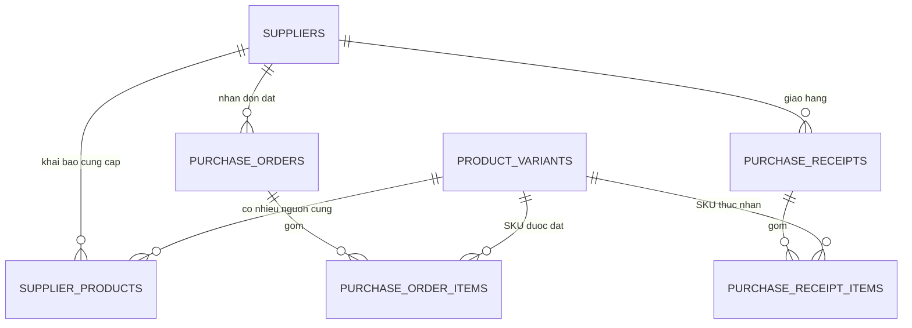

# Bản nháp: mở rộng dữ liệu nhà cung cấp (F03)

Ngày soạn: 04/11/2026. Trạng thái: **đã bổ sung schema Prisma và migration phần cốt lõi** (`20261104090000_f03_supplier_catalog`), chưa áp dụng lên database. Các nhận xét hiện trạng ở mục 2 ghi nhận thời điểm trước khi cập nhật. Xem [hướng dẫn cập nhật Supabase](f03-supplier-supabase.md).

## 1. Nên bổ sung gì trước?

Phần cần nhất là bảng **`supplier_products` nối nhà cung cấp với SKU của cửa hàng**. Một NCC cung cấp nhiều SKU; một SKU có thể mua từ nhiều NCC, với giá và điều kiện đặt khác nhau. Không nên thêm một `supplierId` duy nhất vào `ProductVariant` vì sẽ mất khả năng có nhiều nguồn hàng.

Ví dụ cửa hàng có SKU `SUA-180-KD` (sữa không đường 180 ml):

| NCC | SKU cửa hàng | Mã hàng phía NCC | Giá / hộp | Tối thiểu / bội số đặt | Giao dự kiến |
| --- | --- | --- | --- | --- | --- |
| NCC A | SUA-180-KD | A-MILK-180 | 6.000 | 48 / 48 hộp | 2 ngày |
| NCC B | SUA-180-KD | B-0180 | 6.200 | 24 / 24 hộp | 1 ngày |

Nhờ đó có thể mở NCC A để xem họ đang cung cấp gì, hoặc mở SKU để so sánh các NCC. Hàng cùng nhãn nhưng khác dung tích/hương vị vẫn phải nối vào đúng `ProductVariant`, không chỉ nối vào tên sản phẩm chung (`ProductTemplate`).

## 2. Hiện trạng kiểm tra từ mã nguồn

| Thành phần | Hiện trạng trong checkout này |
| --- | --- |
| `Supplier` trong `prisma/schema.prisma` | Có `id`, `businessId`, `name`, `phone`, `contactPerson`, `debtAmount`, `createdAt` |
| `ProductVariant` | Có SKU, barcode, giá bán, giá vốn và các mặc định `leadTimeDays`, `minOrderQty`, `packSize` |
| PO / phiếu nhận | Đã nối NCC với SKU qua chứng từ; có giá đặt `unitPrice` và giá thực nhận `actualCost` |
| API danh mục NCC | Router và `supplier-products.service.ts` đã có GET/PUT/DELETE, dùng `supplierProduct` và `supplyPrice` |
| Model và migration danh mục | Chưa thấy model `SupplierProduct` trong schema và chưa thấy migration `20261103090000_supplier_products` trong thư mục migrations |
| Tài liệu F03 | Phần “SKU theo nhà cung cấp” có nhắc migration trên và client đã generate, khác với các file schema/migration đang có |

Vì vậy cần đồng bộ lại schema, migration và Prisma Client trước khi hoàn thiện tính năng. Không xem việc có route là bằng chứng bảng đã tồn tại. Bản nháp này chỉ đối chiếu file local, chưa xác minh cấu trúc DB đang chạy hoặc lịch sử migration remote.

**Phân biệt hai danh sách:** “đang cung cấp” là danh mục được khai báo và còn hoạt động; “đã từng mua” được suy ra từ phiếu nhận `RECEIVED`. Một NCC từng giao một SKU không có nghĩa hiện tại vẫn cung cấp SKU đó.

## 3. Thiết kế cốt lõi: `supplier_products`

Tên model đề xuất là `SupplierProduct`, map sang bảng `supplier_products`, để thống nhất với service đang có. Giai đoạn đầu mỗi cặp NCC–SKU có một dòng, tất cả số lượng và giá tính theo **đơn vị tồn kho của SKU**.

| Cột DB / trường Prisma | Kiểu đề xuất | Bắt buộc / mặc định | Ý nghĩa |
| --- | --- | --- | --- |
| `id` / `id` | UUID | PK, tự sinh | ID liên kết cung cấp |
| `business_id` / `businessId` | UUID | Có | Cửa hàng sở hữu dữ liệu |
| `supplier_id` / `supplierId` | UUID | Có | NCC |
| `variant_id` / `variantId` | UUID | Có | SKU nội bộ |
| `supplier_sku` / `supplierSku` | VARCHAR(100) | Không | Mã hàng trong hệ thống NCC; khác SKU nội bộ |
| `supplier_product_name` / `supplierProductName` | VARCHAR(255) | Không | Tên NCC dùng trên báo giá/hóa đơn |
| `supply_price` / `supplyPrice` | DECIMAL(12,2) | Có, không mặc định | Giá chào cho một đơn vị tồn kho; giữ tên đang dùng trong API |
| `min_order_qty` / `minOrderQty` | INTEGER | Có, mặc định 1 | Số đơn vị tồn kho tối thiểu mỗi lần đặt |
| `order_multiple` / `orderMultiple` | INTEGER | Có, mặc định 1 | Số lượng đặt phải là bội số của trường này |
| `lead_time_days` / `leadTimeDays` | INTEGER | Không | Thời gian giao dự kiến riêng của NCC; null dùng mặc định SKU |
| `is_preferred` / `isPreferred` | BOOLEAN | Có, mặc định false | NCC ưu tiên cho SKU này |
| `is_active` / `isActive` | BOOLEAN | Có, mặc định true | Còn cung cấp hay đã ngừng |
| `price_updated_at` / `priceUpdatedAt` | TIMESTAMPTZ | Có, mặc định now | Thời điểm xác nhận giá chào, kể cả xác nhận lại cùng giá |
| `note` / `note` | TEXT | Không | Ghi chú điều kiện cung cấp |
| `created_at`, `updated_at` | TIMESTAMPTZ | Có, mặc định now | Thời điểm tạo/cập nhật; `updatedAt` phải được cập nhật khi ghi |

### Khóa, ràng buộc và index

- Unique `(business_id, supplier_id, variant_id)`; tương ứng selector Prisma `businessId_supplierId_variantId` mà service hiện tại sử dụng.
- Thêm unique `(business_id, id)` trên `suppliers` và `product_variants` làm đích cho FK ghép. FK `(business_id, supplier_id)` → `suppliers(business_id, id)`; `(business_id, variant_id)` → `product_variants(business_id, id)`. Chặn nối dữ liệu hai cửa hàng ngay tại DB; không chỉ dựa vào validation API.
- FK tới `businesses(id)`; các liên kết dùng `ON DELETE RESTRICT`. Bổ sung relation ngược `supplierProducts` vào `Business`, `Supplier`, `ProductVariant` khi viết Prisma.
- CHECK `supply_price >= 0`, `min_order_qty > 0`, `order_multiple > 0`, `lead_time_days IS NULL OR lead_time_days >= 0`.
- CHECK `NOT is_preferred OR is_active`; partial unique index `(business_id, variant_id) WHERE is_preferred = true AND is_active = true` để mỗi SKU có tối đa một NCC ưu tiên đang hoạt động. Đổi NCC ưu tiên trong một transaction.
- Index `(business_id, supplier_id, is_active)` cho danh mục theo NCC; `(business_id, variant_id, is_active)` để tìm nguồn cung cho SKU.
- Chưa ép unique `supplier_sku`: cần xác nhận cách NCC đánh mã và đóng gói trước. Chuỗi trống chuẩn hóa thành null.

### Quy tắc nghiệp vụ cần chốt cùng bảng này

1. Tạo/sửa PO phải kiểm tra NCC, SKU và liên kết cung cấp cùng cửa hàng, đều đang hoạt động. Service tạo PO hiện tại mới kiểm tra NCC và SKU, chưa buộc SKU thuộc danh mục NCC. UI có thể cho “thêm SKU vào danh mục NCC” rồi chọn mua; không tự thêm chỉ vì có lịch sử nhận hàng.
2. `supplyPrice` chỉ gợi ý giá đặt. `PurchaseOrderItem.unitPrice` lưu giá đã thỏa thuận; `PurchaseReceiptItem.actualCost` lưu giá thực nhận. Giá chào mới không sửa chứng từ cũ và không ghi đè `ProductVariant.costPrice` (giá vốn).
3. Số lượng PO phải `>= minOrderQty` và chia hết cho `orderMultiple`; phiếu nhận từng đợt được nhận lẻ, không ép lại bội số đặt. `leadTimeDays` của liên kết ưu tiên hơn mặc định SKU. `minOrderQty` và `orderMultiple` trên liên kết là điều kiện mua riêng, không tự đồng bộ sang `ProductVariant.minOrderQty/packSize`.
4. Ngừng cung cấp dùng `isActive=false`, đồng thời bỏ ưu tiên; thêm lại kích hoạt chính dòng cũ. API DELETE hiện đang xóa thật liên kết nên cần đổi hành vi hoặc thay bằng PATCH trước khi áp dụng thiết kế này.
5. Liên kết/NCC ngừng hoạt động chặn PO mới và việc thêm dòng mua mới. PO đã đặt vẫn được nhận phần còn lại và thanh toán theo chứng từ; SKU khóa kiểm kê hoặc ngừng hoạt động vẫn tuân thủ kiểm tra nhận hàng hiện có.
6. Giai đoạn đầu quy ước giá VND cho một đơn vị tồn kho, cùng cơ sở giá với PO, chưa bóc VAT/chiết khấu. UI phải ghi rõ đơn vị và cơ sở giá để tránh so sánh nhầm giá thùng với giá hộp.

### Sơ đồ quan hệ đề xuất

Không cần thêm `supplierId` vào lô để giải quyết danh mục: nguồn nhận được truy qua phiếu nhận. Một lô có thể được nhận nhiều lần từ nhiều NCC; gắn một NCC duy nhất vào lô dễ làm sai nguồn gốc.

## 4. Bổ sung hồ sơ `suppliers`

Giữ nguyên các trường đang có, đề xuất thêm:

| Cột | Kiểu | Mục đích / quy tắc |
| --- | --- | --- |
| `supplier_code` | VARCHAR(50), nullable lúc migrate | Mã quản lý như NCC0001; unique `(business_id, supplier_code)`, backfill rồi mới cân nhắc NOT NULL |
| `email` | VARCHAR(255), nullable | Gửi yêu cầu báo giá/liên hệ |
| `address` | TEXT, nullable | Địa chỉ liên hệ |
| `tax_code` | VARCHAR(30), nullable | Mã số thuế nếu có; chưa mặc định unique theo NCC |
| `note` | TEXT, nullable | Ghi chú chung |
| `is_active` | BOOLEAN NOT NULL DEFAULT true | Ngừng hợp tác nhưng giữ lịch sử và công nợ |
| `updated_at` | TIMESTAMPTZ NOT NULL DEFAULT now | Cập nhật khi sửa hồ sơ |

Không cho sửa `debtAmount` qua form hồ sơ. Công nợ tiếp tục đi qua chứng từ và luồng đối soát hiện tại. API tạo/sửa phải liệt kê rõ trường được phép ghi.

Nếu mỗi NCC chỉ có một người liên hệ thì giữ `contactPerson` và `phone`. Khi cần nhiều nhân viên kinh doanh/kế toán mới tách bảng `supplier_contacts`; chưa cần tạo nhiều bảng liên hệ ngay.

## 5. Các bảng mở rộng sau khi có nhu cầu

| Ưu tiên | Bảng / thay đổi | Khi nào cần và dữ liệu chính |
| --- | --- | --- |
| Sau phần cốt lõi | `supplier_product_price_history` | Khi cần lịch sử giá chào: `id`, `business_id`, `supplier_product_id`, `supply_price`, `recorded_at`, `recorded_by`, `note`; append mỗi lần đổi giá, FK ghép cùng cửa hàng |
| Sau phần cốt lõi | `supplier_contacts` | Nhiều đầu mối: `id`, `business_id`, `supplier_id`, `name`, `role`, `phone`, `email`, `is_primary`, `is_active`; tối đa một liên hệ chính đang hoạt động / NCC |
| Khi mua theo nhiều quy cách | `supplier_product_packagings` | Một NCC bán cùng SKU theo lốc/thùng: `supplier_product_id`, `packaging_code`, `units_per_pack`, `price_per_pack`, `min_packs`, `is_active`; khi đó unique cặp NCC–SKU vẫn ở bảng cha, các quy cách ở bảng con |
| Khi có nghiệp vụ báo giá | `supplier_quotes`, `supplier_quote_items` | Báo giá có mã, ngày hiệu lực/hết hạn, nhiều dòng, trạng thái; thay vì chỉ giữ giá mới nhất |
| Khi mở rộng công nợ | Thêm điều khoản NCC và hạn trả trên chứng từ | `payment_term_days`, `credit_limit` trên NCC; lưu snapshot điều khoản và `due_date` trên phiếu để thay điều khoản không làm đổi hạn nợ cũ |

Nếu triển khai bảng giá lịch sử, cập nhật giá hiện tại và ghi lịch sử trong cùng transaction. Lịch sử giá nhập thực tế đã có ở phiếu nhận, không cần sao chép thành một bảng “lịch sử mua” nữa. Chỉ thêm số liệu tổng hợp/cache sau khi có nhu cầu hiệu năng rõ ràng.

## 6. Gắn vào luồng mua hàng và giao diện

- Trang NCC: thêm tab **Sản phẩm đang cung cấp** và **Lịch sử đã nhập**. Danh mục hiển thị SKU, tên hàng, mã NCC, giá chào, lượng đặt tối thiểu, bội số, thời gian giao và trạng thái.
- Trang SKU: danh sách NCC cùng giá/điều kiện và thao tác chọn NCC ưu tiên.
- Tạo PO: chọn NCC → chọn SKU trong danh mục → điền giá gợi ý → kiểm tra lượng đặt. Người dùng vẫn được sửa giá thỏa thuận trước khi lưu.
- Nhận hàng: giữ luồng tồn kho, lô, giá vốn, công nợ hiện tại. Không tự thay giá chào khi giá nhận khác báo giá.
- Chứng từ: `unitPrice`, `orderedQty`, `actualCost` hiện có đã lưu số liệu giao dịch. Nếu cần in điều kiện mua lịch sử, thêm snapshot `supplier_sku`, `min_order_qty`, `order_multiple`, `lead_time_days` trên dòng PO; không đọc điều kiện hiện tại để diễn giải đơn cũ.

Giữ các endpoint danh mục đã có và mở rộng payload PUT bằng những trường ở mục 3; bổ sung PATCH hồ sơ/trạng thái NCC và PATCH trạng thái liên kết. GET catalog mặc định lọc liên kết hoạt động; có filter riêng để quản lý dòng đã ngừng. GET history vẫn dựa trên phiếu `RECEIVED`, kể cả liên kết đã ngừng. Quyền đọc/ghi giai đoạn đầu theo router F03 hiện tại; không đưa giá nhập/công nợ sang API không có quyền `finance.read`.

## 7. Lộ trình triển khai và dữ liệu cũ

1. Đối chiếu schema local, Prisma Client đang sinh và DB đích; xác định bảng `supplier_products` thực tế đã tồn tại hay chưa. Kiểm tra tài liệu nhắc migration bị thiếu; khôi phục đúng nội dung nếu tìm được, tránh tạo bảng trùng hoặc chạy toàn bộ migration pending để thử.
2. Viết migration thêm trường hồ sơ và bảng nối/ràng buộc; nếu bảng đã có thì viết thay đổi tăng dần từ cấu trúc đã xác minh. Generate lại Prisma Client từ schema đã đồng bộ.
3. Cho khai báo danh mục thủ công. Có thể xuất cặp NCC–SKU từ phiếu `RECEIVED` làm danh sách **gợi ý chờ xác nhận**, không tự xác nhận còn cung cấp và không dùng giá vốn làm giá chào. Dữ liệu mẫu phải được NCC/người quản lý xác nhận giá và đơn vị.
4. Bổ sung API, UI, lọc trạng thái và validation PO. Đơn cũ chưa có liên kết vẫn được nhận/thanh toán; khi sửa thêm SKU phải khai báo liên kết trước. Không bắt buộc backfill điều kiện mua cho chứng từ cũ bằng điều kiện hiện tại.
5. Kiểm tra trên DB thử nghiệm: unique/FK ghép, CHECK, index NCC ưu tiên, chuyển ưu tiên đồng thời, rollback và quyền theo cửa hàng. Kiểm tra luồng PO → nhận từng phần → thanh toán để bảo đảm không đổi cách tính kho/nợ.

### Tiêu chí hoàn thành phần cốt lõi

- Một NCC có nhiều SKU; cùng SKU có nhiều NCC với giá và điều kiện khác nhau.
- Cặp NCC–SKU không trùng; không thể nối dữ liệu chéo cửa hàng, kể cả ghi trực tiếp DB.
- Đặt sai SKU NCC, dưới tối thiểu hoặc sai bội số bị từ chối; nhận từng phần vẫn hợp lệ.
- Đổi giá chào không làm thay đổi giá vốn, PO hoặc phiếu cũ.
- Ngừng cung cấp không mất lịch sử; đơn đã đặt vẫn xử lý phần còn lại theo quy tắc trên.
- Chưa từng mua vẫn thêm được vào danh mục; đã từng mua không tự thành nguồn cung hiện tại.

**Phạm vi khuyến nghị cho lần đầu:** hoàn thiện `supplier_products`, bổ sung hồ sơ/trạng thái NCC, nối danh mục vào chọn SKU và kiểm tra PO. Các bảng ở mục 5 triển khai theo nhu cầu, chưa cần làm hết cùng lúc.

## 8. File tham chiếu

- [Luồng và API F03 hiện tại](f03-purchases.md)
- [Schema Prisma hiện tại](../prisma/schema.prisma)
- [Service danh mục NCC](../src/modules/purchases/supplier-products.service.ts)
- [Tạo PO và nhận hàng](../src/modules/purchases/purchases-write.service.ts)
- [Router và quyền F03](../src/modules/purchases/purchases.routes.ts)
