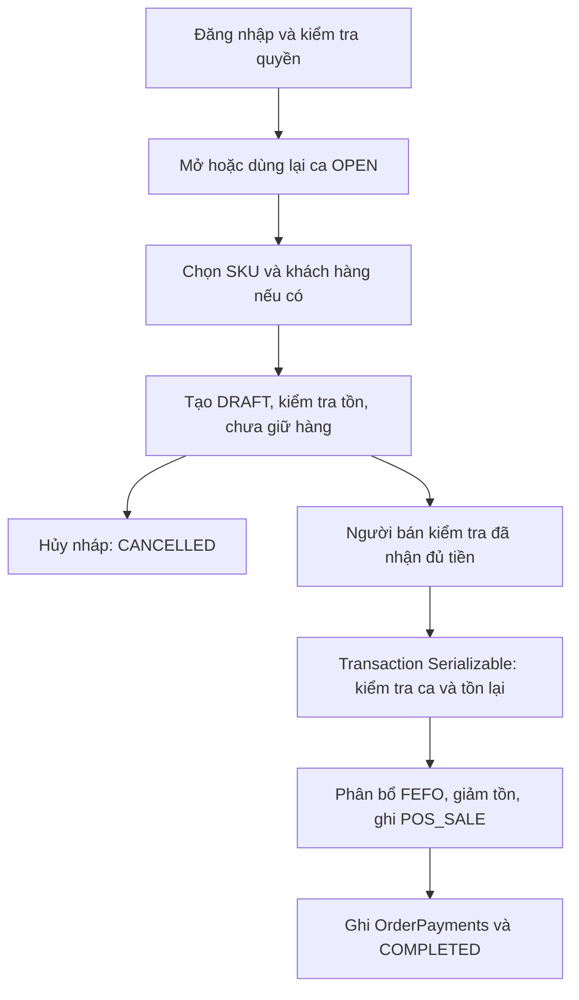

# F04 — Bán hàng tại quầy và thanh toán

## 1. Luồng nghiệp vụ

Users (chủ cửa hàng/nhân viên) → mở CashShifts → tạo Orders thuộc Businesses → chọn ProductVariants và số lượng → gắn Customers nếu có → kiểm tra InventoryBalances → xác nhận đã thu đủ tiền → ghi OrderPayments, giảm tồn và ghi InventoryLedger POS_SALE → COMPLETED.



| Thao tác | Trạng thái | Tồn kho / tiền |
| --- | --- | --- |
| Tạo đơn | DRAFT | Kiểm tra đủ hàng, chưa trừ/giữ kho, chưa ghi thanh toán |
| Xác nhận thanh toán | COMPLETED | Trừ kho + ghi ledger + payment cùng transaction |
| Hủy nháp chưa trả tiền | CANCELLED | Không đổi kho/tiền; hủy lại trả cùng đơn |
| Lỗi bất kỳ bước xác nhận | Giữ DRAFT | Rollback toàn bộ |

Quy tắc:

- `businessId` lấy từ membership, token qua Supabase. ID cửa hàng khác trả 404; gửi businessId khác trả 403 tại middleware.
- API đọc cần `orders.read`; ghi cần thêm `orders.create`. API inventory để chuẩn bị/đối chiếu cần thêm `inventory.read`.
- Mở ca dùng lại ca OPEN của chính người thao tác, chia sẻ ca với F03. Tạo đơn cần ca OPEN thuộc người đó/cửa hàng; trả tiền cần chính ca gốc vẫn OPEN và chính cashier tạo đơn. Không tự chuyển đơn sang ca khác.
- Giá bán lấy từ `ProductVariants.basePrice` lúc tạo nháp, không nhận giá client; giá đã chốt trên nháp được giữ khi thanh toán. Giá vốn lấy lại khi hoàn tất. Không có giảm giá, thuế hoặc sửa nháp; có thể hủy rồi tạo đơn mới với mã khác.
- `items` có 1–500 SKU không lặp; quantity là số nguyên 1–2147483647. orderCode dài 1–50, duy nhất trong cửa hàng.
- Chỉ bán SKU đang hoạt động, không khóa kiểm kê. Tồn bán được = quantityOnHand − damagedQuantity. Không bán phần hỏng.
- Với SKU quản lý lô: chỉ dùng lô cùng cửa hàng/SKU có expirationDate >= hôm nay theo Việt Nam UTC+7; lô hết hạn hôm nay vẫn được bán. Chọn hạn gần nhất, hòa hạn theo ID balance. Có thể tách một SKU thành nhiều OrderItems theo lô khi hoàn tất. Nháp lưu một dòng/SKU, chưa chốt lô.
- Với SKU không quản lý lô: chỉ dùng balance lotId = null. Thiếu tồn bán được trả 409; nháp không giữ chỗ nên có thể thiếu hàng lúc thanh toán.
- Chỉ thanh toán **đủ một lần**, `CASH` hoặc `BANK_TRANSFER`. amount phải bằng totalNetAmount và > 0. Tổng/giá/giá vốn phải < 10 tỷ, tối đa 2 chữ số lẻ; response decimal là chuỗi. Chưa hỗ trợ đơn tổng 0.
- `confirmed: true` là xác nhận thủ công của người bán đã thu tiền. API không chuyển tiền, không tự kiểm chứng giao dịch ngân hàng; paymentReference là thông tin đối chiếu tùy chọn, không phải khóa chống lặp.
- Payment liên kết orderId và shiftId; không tạo CashTransaction thu bán hàng lần nữa. OrderPayments là nguồn thu bán hàng, tránh cộng hai lần khi đối chiếu ca.
- Ledger: transactionType POS_SALE, quantityChanged âm, totalCostValue âm theo giá vốn; balanceAfter là tồn balance của lô, referenceDocType ORDER, referenceDocId = orderId. Giá vốn SKU không đổi do bán. totalCogsAmount = tổng lượng × giá vốn; grossProfit = totalNetAmount − totalCogsAmount, có thể âm.
- Transaction Serializable thử tối đa 3 lần khi P2034, hết số lần trả 409. Gửi thanh toán lần hai sau thành công trả 409, không trừ kho/thu tiền lần hai. Sau mất kết nối hãy GET đơn để kiểm tra trước khi thử lại.

## 2. API F04

Base URL: `http://localhost:5000/api` (đổi cổng nếu PORT khác).

| Method | Đường dẫn | Kết quả |
| --- | --- | --- |
| GET | /sales/customers | 200: danh sách/tìm khách theo tên hoặc điện thoại |
| POST | /sales/customers | 201: tạo khách name, phone bắt buộc; điện thoại duy nhất trong cửa hàng |
| GET | /sales/cash-shifts/current | 200: ca OPEN hiện tại hoặc null |
| POST | /sales/cash-shifts | 200: mở hoặc lấy lại ca OPEN, openingCash mặc định 0 |
| GET | /sales/orders | 200: danh sách đơn |
| GET | /sales/orders/:id | 200: đơn, orderItems, orderPayments, customer, inventoryLedger |
| POST | /sales/orders | 201: tạo DRAFT, chưa trừ kho |
| POST | /sales/orders/:id/payments | 200: ghi thanh toán, xuất kho, hoàn tất đơn |
| POST | /sales/orders/:id/cancel | 200: hủy DRAFT chưa trả tiền |

Danh sách trả `{ items, pagination: { page, pageSize, total, totalPages } }`. Query page mặc định 1, tối đa 1000000; pageSize mặc định 20, tối đa 100; search tối đa 255 ký tự. Đơn tìm theo orderCode, hỗ trợ status DRAFT/COMPLETED/CANCELLED và from/to dạng YYYY-MM-DD, gồm cả hai ngày theo UTC; from <= to. Khách dùng page/pageSize/search.

## 3. Swagger riêng và chuẩn bị test

Từ `abc-backend`, chạy `npm run dev`, mở **http://localhost:5000/fo4/**.

OpenAPI: **http://localhost:5000/fo4/openapi.json**. Trang này chỉ có 9 API F04 cùng đăng nhập, auth/me, health và inventory variants/lots/ledger phục vụ chuẩn bị/đối chiếu. F03 vẫn ở `/fo3/`; hai trang có initializer riêng.

1. Dùng DB thử nghiệm đã có schema và dữ liệu SKU/tồn, cấu hình backend `.env` như F03. Không chạy các thao tác ghi trên dữ liệu đang vận hành.
2. Cấu hình SUPABASE_URL và SUPABASE_ANON_KEY (public anon key) để có POST /auth/v1/token. Nhập email/password tài khoản hiện có, Execute; Swagger tự Authorize access_token. CAPTCHA nếu được bật cần captcha_token. Có thể dán access token frontend vào Authorize. Token chỉ nằm trong bộ nhớ trang, reload cần đăng nhập lại.
3. GET /auth/me kiểm tra membership và orders.read + orders.create; inventory.read để xem tồn/lô/ledger. Không cần inventory.receive hoặc finance.read cho API sales.
4. Chuẩn bị SKU đang hoạt động, không khóa kiểm kê, không quản lý lô, basePrice = 50000, tồn bán được >= 3. Ghi variantId, tồn đầu Q0, damagedQuantity H0 và giá vốn C0. Dùng SKU riêng, không nhập/xuất/điều chỉnh trong lúc đối chiếu.
5. Dùng mã mới mỗi lần chạy, ví dụ POS-F04-20261101-01. Thay UUID mẫu và các biến bên dưới bằng ID thật trong Swagger; Swagger không tự nội suy biến Postman.

Với Postman: Environment `baseUrl = http://localhost:5000/api`, `token`, `variantId`, `customerId`, `shiftId`, `orderId`, `runId`. Collection dùng Bearer `{{token}}`; body raw JSON. ID là UUID từ response, không phải mã SKU/đơn.

## 4. Test luồng chính

### 4.1. Mở ca

GET `/sales/cash-shifts/current`, sau đó POST `/sales/cash-shifts`:

```json
{ "openingCash": "100000.00" }
```

Mong đợi 200, status OPEN, đúng userId; lưu id làm shiftId. Nếu đã có ca OPEN, API trả ca cũ và không thay openingCash. POST lại trả cùng ID.

### 4.2. Tạo khách (tùy chọn)

POST `/sales/customers`:

```json
{ "name": "Khách test F04", "phone": "0901234567" }
```

Mong đợi 201, lưu id thành customerId. GET `/sales/customers?search=0901234567` tìm thấy khách. Nếu điện thoại đã có trong cửa hàng thì dùng khách cũ hoặc số khác; tạo trùng trả 409. name 1–150 ký tự, phone 1–20.

### 4.3. Tạo nháp

POST `/sales/orders`:

```json
{
  "orderCode": "POS-F04-20261101-01",
  "shiftId": "<shiftId>",
  "customerId": "<customerId>",
  "items": [{ "variantId": "<variantId>", "quantity": 3 }]
}
```

Có thể bỏ customerId để bán khách vãng lai; bỏ shiftId để dùng ca OPEN mới nhất của chính người thao tác.

Mong đợi 201, status DRAFT, totalGrossAmount = totalNetAmount = 150000, một dòng 3 × 50000, orderPayments rỗng. Lưu response.id làm orderId. GET `/sales/orders/<orderId>` và `/sales/orders?search=POS-F04-20261101-01`: tìm thấy đơn; kho vẫn Q0, không có ledger ORDER cho đơn này.

### 4.4. Xác nhận đã thu tiền mặt

Sau khi đã kiểm tra nhận đủ tiền thực tế, POST `/sales/orders/<orderId>/payments`:

```json
{ "confirmed": true, "paymentMethod": "CASH", "amount": "150000.00" }
```

Mong đợi 200, status COMPLETED. GET đơn và API inventory để xác minh dữ liệu đã lưu:

| Dữ liệu | Mong đợi |
| --- | --- |
| totalNetAmount | 150000 |
| orderPayments | Đúng 1 khoản CASH 150000, đúng orderId và shiftId |
| Tồn SKU | Q0 − 3; damagedQuantity vẫn H0 |
| inventoryLedger của đơn | POS_SALE, quantityChanged −3, balanceAfter Q0 − 3 |
| Giá vốn ledger | unitCost C0, totalCostValue −3 × C0 |
| totalCogsAmount / grossProfit | 3 × C0 / 150000 − 3 × C0 |
| Ca | Vẫn OPEN |

Gửi lại cùng payment: 409, các số trên giữ nguyên. Hủy đơn COMPLETED: 409. GET `/sales/orders?status=COMPLETED` thấy đơn.

### 4.5. Chuyển khoản

Tạo đơn mới, mã mới, rồi POST payments của đơn mới:

```json
{
  "confirmed": true,
  "paymentMethod": "BANK_TRANSFER",
  "amount": "150000.00",
  "paymentReference": "FT-F04-001"
}
```

Mong đợi giống 4.4, phương thức BANK_TRANSFER và đúng tham chiếu. Chỉ xác nhận sau khi kiểm tra giao dịch chuyển khoản. Không có tích hợp ngân hàng trong API này.

## 5. Test FEFO, hủy và các nhánh lỗi

Mỗi nhánh dùng đơn/mã mới, ghi lại snapshot kho/đơn/payment/ledger trước và sau.

| Case | Chuẩn bị / thao tác | Mong đợi |
| --- | --- | --- |
| LOT01 | SKU quản lý lô: A hết hạn gần hơn có tồn 2, B hạn xa có tồn 5; bán 3 | COMPLETED có dòng A × 2, B × 1; ledger/tồn tương ứng |
| LOT02 | Có lô hết hạn hôm qua và lô còn hạn | Không chọn lô hết hạn; nếu phần còn hạn thiếu trả 409 |
| LOT03 | Lô hết hạn đúng hôm nay Việt Nam | Được dùng nếu còn tồn tốt |
| LOT04 | Lô A tồn 3, hỏng 1; bán 3 với lô B đủ tồn | A tối đa 2; phần còn lại từ B; hàng hỏng giữ nguyên |
| LOT05 | Tạo nháp rồi SKU bị xuất bớt, hoặc đổi tồn các lô | Thanh toán tính FEFO lại; đủ thì phân bổ theo tồn mới, thiếu thì 409 |
| CAN01 | POST cancel nháp, gọi lại cancel | 200 cả hai, CANCELLED; kho/tiền/ledger không đổi |
| CAN02 | Thanh toán đơn CANCELLED hoặc hủy COMPLETED | 409, không ghi thêm |
| VAL01 | quantity 0/âm/lẻ, UUID sai, items rỗng/>500, lặp SKU | 400 |
| VAL02 | amount âm/0/lẻ quá 2 số, sai tổng hoặc thiếu confirmed true | 400, nháp và kho giữ nguyên |
| VAL03 | paymentMethod VIETQR/khác, trường tên/phone/mã quá dài | 400 |
| DUP01 | Tạo đơn trùng orderCode trong cùng cửa hàng | 409, không tạo đơn/giữ kho |
| SHIFT01 | Không có ca OPEN hoặc chỉ có ca của người khác | Tạo đơn 409 |
| SHIFT02 | Ca gốc đã đóng; người bán có ca mới OPEN | Thanh toán 409; không tự chuyển ca |
| USER01 | Người khác thanh toán/hủy nháp | 403 hoặc 409 nếu không có ca gốc hợp lệ; không thay đơn |
| SKU01 | SKU không hoạt động / không thuộc cửa hàng | 404 |
| STOCK01 | SKU khóa kiểm kê hoặc thiếu tồn tốt | 409, không thanh toán/trừ kho |
| AUTH01 | Thiếu/sai token | 401 |
| AUTH02 | Thiếu orders.read, hoặc thiếu orders.create khi ghi | 403; test từng quyền riêng |
| SCOPE01 | businessId khác trong body/query | 403 |
| SCOPE02 | UUID đơn/khách/SKU thuộc cửa hàng khác | 404, không lộ dữ liệu |
| TX01 | Lỗi muộn khi ghi ledger của một dòng | Rollback toàn bộ tồn/line/payment/ledger/status |
| TX02 | Hai request cùng thanh toán một đơn | Chỉ một COMPLETED/payment; request còn lại 409 |
| TX03 | Hai đơn tranh lượng tồn cuối | Không bán vượt tồn tốt; request còn lại 409 nếu không đủ |

TX01 tự động dùng mock tại DB boundary. TX02/TX03 cần chạy thêm trên PostgreSQL thử nghiệm để xác nhận isolation/unique constraints thật. Có thể gửi song song hai request từ hai tab Postman/Swagger; đối chiếu số dòng và tổng lượng trước/sau. Không dùng request mới khi chưa kiểm tra trạng thái request bị mất kết nối.

## 6. Kiểm thử tự động

Tại `abc-backend`, mỗi suite chạy riêng để mock DB không lẫn nhau:

```powershell
npx tsc --noEmit
node --test --test-isolation=none tests/sales.test.cjs
node --test --test-isolation=none tests/fo4-swagger.test.cjs
node --test --test-isolation=none tests/fo3-swagger.test.cjs
```

`sales.test.cjs`: nháp không trừ kho, giá server, trả đủ tiền, chống trả lặp, chuyển khoản, FEFO chia lô, loại hàng hỏng/hết hạn, tồn đổi sau nháp, rollback lỗi muộn, ca/người/cửa hàng, validation, hủy và retry Serializable. `fo4-swagger.test.cjs`: đủ 9 routes, schema refs hợp lệ, trang/asset/login hoạt động, F03/F04 độc lập, chặn request thiếu token.

Suite dùng mock, không chứng minh PostgreSQL/Supabase thật đã hoạt động. Manual test cần ghi mã case, ID/mã đơn, request đã ẩn token, HTTP thực tế, snapshot trước/sau đơn/kho/payment/ledger và PASS/FAIL. Không ghi token/password vào báo cáo.

## 7. Mã nguồn và phạm vi

- `src/modules/sales/sales.routes.ts`: 9 API và quyền.
- `src/modules/sales/sales.service.ts`: khách/đơn, FEFO, payment và hủy nháp.
- `src/docs/fo4.openapi.ts`, `fo4.routes.ts`: OpenAPI và Swagger UI riêng.
- Dùng chung validation/transaction/actor và dịch vụ mở ca của F03; không cần migration cho API này vì schema đã có đủ bảng/cột.
- Chưa có UI POS frontend, sửa nháp, đóng ca, thanh toán một phần/nhiều phương thức, tích hợp xác nhận ngân hàng, hoàn tiền hoặc hủy đơn đã hoàn tất. Các phần này nằm ngoài conceptual F04 hiện tại.
